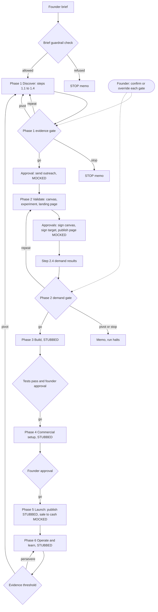
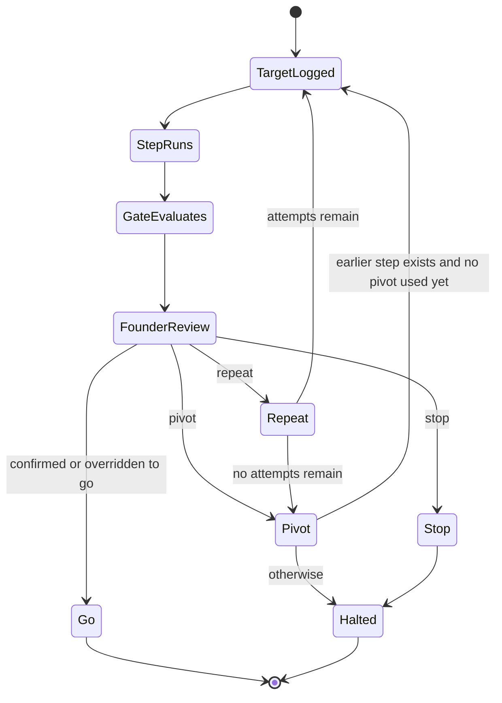
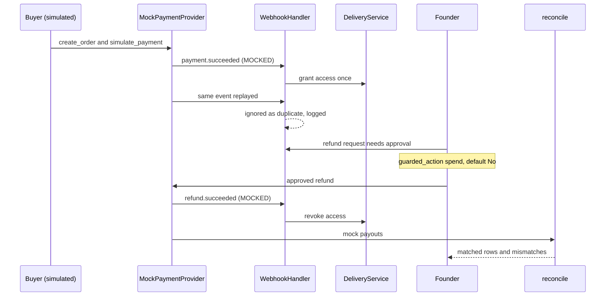
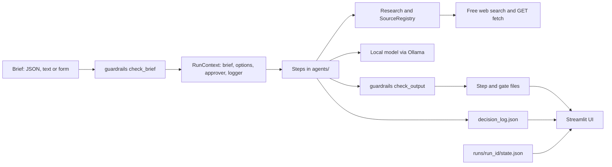

# Architecture

## Overview

AI Cofounder is a pipeline of small agents, each one a registered step (`agents/<role>.py`), run by `orchestrator.py` from a founder brief. After every step one or more gates (`gates.py`) recommend **go / repeat / pivot / stop** against a target that was logged before the step ran. The founder controls the run: they confirm or override every reviewable gate, and nothing is published, sent, spent or signed unless they explicitly approve that one action through `approval.guarded_action` (default No; silence is No). Guardrails (`guardrails.py`) check the brief, every request and every output, and every action is appended to a decision log (`decision_log.py`). Phases 1 and 2 are built; the sale-to-cash part of Phase 5 is a MOCKED local simulation; Phases 3, 4, 6 and the store are STUBBED (designed, not built).

Legend: **Working** = built and covered by tests; **MOCKED** = runs, but the outside effect is simulated (nothing leaves the machine, no money); **STUBBED** = designed, not built. The full status table is in [Built vs. stubbed](#built-vs-stubbed).

## Phases

The steps run in this order: 1.1, 1.2, 1.3, 1.4, Phase 1 gate, 1.5, then (only after a Phase 1 GO) 2.1, 2.2, 2.3, 2.4 and the Phase 2 gate. A step is a class with `phase`, `step`, `name`, `agent` and `run(ctx)`, registered with `@register_step` (`steps.py`); it may name its gates (`default_gates()`), where a REPEAT goes back to (`repeat_from`) and where a PIVOT goes back to (`pivot_to`). Every agent prompt is a file in `prompts/`. Output files are named `phase<N>_step<M>_<name>.md` and `phase<N>_gate_<name>.md` (a rerun adds `_attempt2`, `_attempt3`). Detail per step: [docs/phases.md](docs/phases.md).

### Phase 1: Discover

- **Agents:** `agents/researcher.py` (1.1 opportunities), `agents/scorer.py` (1.2 idea scoring), `agents/market_analyst.py` (1.3 market), `agents/interviewer.py` (1.4 interviews, 1.5 outreach).
- **Tools:** the local model through `llm.py` (JSON constrained by a schema, one retry); free keyless search in `tools/search.py` (`ddgs` with bing / yahoo / duckduckgo backends, Hacker News Algolia, Wikipedia; Reddit search is tried and returned 403 from our network); `tools/fetch.py` (GET only, public addresses only, 8 s timeout, 1 MB cap); `tools/research.py` (budget, cache, `SourceRegistry`). Budget per run: 8 searches and 10 fetches (`--fast`: 5 and 5), from `config/research.json`.
- **Method (Find opportunities, the Core step):** 1.1 the model writes a problem statement, target user and 2-3 search queries; the tools search and fetch pages; the model extracts pain signals (complaints, questions, paid workarounds) and 2-3 alternative ideas, each citing a retrieved source. A citation of a URL the run did not retrieve, or a signal whose wording does not match the retrieved text (word overlap below 0.3), is downgraded to ASSUMPTION and logged. 1.2 the model gives 1-5 sub-scores for founder fit, budget, time, values, differentiation and digital delivery; pain evidence is scored in Python from the number of sourced signals, and the weighted total is computed in Python (`config/scoring.json`). 1.3 segment, beachhead and use case (ASSUMPTION), competitors kept only with a retrieved source, market size only if sourced (otherwise "unknown — ASSUMPTION"). 1.4 a Mom Test interview script (leading or hypothetical questions are dropped by a regex), a recruiting plan, an outreach DRAFT, and, with `--interviews notes.md`, a summary of the founder's real notes (labelled as notes, never counted by the gate). 1.5 asks the founder whether to send the draft through `guarded_action("send")`; the executor is MOCKED and sends nothing.
- **Output:** phase1_step1_opportunities.md, phase1_step2_idea_scoring.md, phase1_step3_market.md, phase1_step4_interviews.md, phase1_gate_discover.md, phase1_step5_outreach.md; a halted run adds phase1_gate_stop_memo.md.
- **Gate:** the Phase 1 evidence gate (`Phase1EvidenceGate`) after step 1.4; see [Gates](#gates).
- **Status:** Working; step 1.5 sending is MOCKED. Simulated interview personas were planned and are not built.

### Phase 2: Validate

- **Agents:** `agents/strategist.py` (2.1 lean_canvas), `agents/experimenter.py` (2.2 experiment), `agents/copywriter.py` (2.3 landing_page), `agents/analyst.py` (2.4 demand_results, no model).
- **Tools:** the local model; the Phase 1 results and their `SourceRegistry`; `guardrails.check_landing_page`; Python's `csv` and `hashlib`.
- **Method (Design the business, the Core step):** 2.1 builds the 9-box Lean Canvas from the Phase 1 findings; an item keeps a source only if Phase 1 used that source, everything else is ASSUMPTION; revenue is a price hypothesis, and projections or income promises are dropped and logged; it lists the 3 riskiest assumptions with a cheap test each. The founder signs the canvas off (a "sign" approval; No redoes the step with the founder's note). 2.2 designs one demand test: hypothesis, free channels, kill criteria and a target (default 100 waitlist sign-ups in 14 days with at least 5% conversion; the agent may only propose a stricter target, up to 1,000). The founder approves the target before any result exists; it is then stored with its SHA-256 hash, and any later change is refused and logged. 2.3 writes one self-contained HTML waitlist page (inline CSS, no scripts, no trackers), checked by `check_landing_page`; its form is MOCKED (no action, disabled button, visible label "MOCKED — demo form"). Publishing goes through `guarded_action("publish")`, and the MOCKED executor only writes a local copy under the run folder. 2.4 counts the evidence in Python: a waitlist CSV (`--waitlist`, only counts kept, duplicates and invalid emails dropped, rows dated outside the test window dropped; an unreadable export is STOP, with no fallback to other numbers), founder-reported numbers (`--signups`, `--visitors`; in the app, the uploaded CSV's row count is passed as founder-reported sign-ups, counted in memory with no de-duplication and no date window, and no email is stored), or MOCKED demo numbers (`--mock-signups`, `--mock-visitors`), labelled MOCKED in every Phase 2 file. With no data the gate says STOP ("demand test not run yet"); the run can be continued later with `--resume <run_id> --from phase2`.
- **Output:** phase2_step1_lean_canvas.md, phase2_gate_founder_approval_canvas.md, phase2_step2_experiment.md, phase2_gate_founder_approval_target.md, phase2_step3_landing_page.md and phase2_step3_landing_page.html, phase2_gate_founder_approval_publish.md, phase2_step4_demand_results.md, phase2_gate_validate.md.
- **Gate:** three founder-approval gates (canvas, target, publish) and the Phase 2 demand gate (`Phase2DemandGate`) after step 2.4.
- **Status:** Working; publishing, the waitlist form and the demo sign-up numbers are MOCKED. Phase 2 is verified by the tests in `tests/test_validate_m3.py`, not by the committed demo: in that demo the decent brief stopped at the Phase 1 gate, so Phase 2 never ran and there is no committed Phase 2 output.

### Phase 3: Build

- **Agents (designed):** a builder agent drafts the MVP spec and code; a test agent writes and runs the tests; a docs agent writes the user docs.
- **Tools (designed):** the local model, a sandboxed working folder, `pytest`.
- **Method (Build the product, the Core step):** the builder turns the signed Lean Canvas and the validated message into a small spec, then code; the test agent writes tests from the spec and runs them; failures go back to the builder (REPEAT); the docs agent writes a quick-start for buyers.
- **Output (designed):** phase3_step1_spec.md, phase3_step2_tests.md, phase3_step3_user_docs.md, phase3_gate_tests.md.
- **Gate:** tests pass (the existing generic `TestsPassGate` in `gates.py`) and founder approval.
- **Status:** STUBBED (not built).

### Phase 4: Commercial setup

- **Agents (designed):** a pricing agent and a policy agent.
- **Tools (designed):** the local model, the free search tools, the `SourceRegistry`.
- **Method (Set the price and policies, the Core step):** the pricing agent proposes 2-3 price options from sourced competitor prices (each with its URL, otherwise ASSUMPTION) and the founder's values. The policy agent drafts terms, privacy and refund policies, each labelled "draft, not legal advice — review by a qualified person". No payment account is created.
- **Output (designed):** phase4_step1_pricing.md, phase4_step2_policies.md, phase4_gate_founder_approval.md.
- **Gate:** founder approval ("sign").
- **Status:** STUBBED (not built).

### Phase 5: Launch (sell, deliver, get paid)

- **Agents and modules:** designed: an offer-page drafter (Open the store); built as a MOCKED simulation: `payments.py`, `webhooks.py`, `delivery.py`, `refunds.py`, `reconcile.py`, run by `scripts/payment_test.py`.
- **Tools:** no payment provider, no sandbox, no SDK: an in-memory simulation in integer cents.
- **Method (Open the store; deliver automatically, the Core step):** the offer page would be published only via `guarded_action("publish")` (STUBBED). A MOCKED payment event grants access once, a duplicate event is ignored, a founder-approved refund revokes access, and reconciliation matches orders, payments, fees and payouts; see [Sale to cash](#sale-to-cash). The simulation is a standalone script; it is not yet connected to the Phase 1-2 pipeline.
- **Output:** [outputs/payment_test_log.md](outputs/payment_test_log.md) (first line "MOCKED — no real payments"), committed from the founder-run `python scripts/payment_test.py --demo`: the duplicate webhook was ignored, the founder approved the refund and access was revoked, and the planted payout mismatch was found.
- **Gate:** founder approval for publish and for every refund ("spend").
- **Status:** sale to cash MOCKED; opening the store STUBBED.

### Phase 6: Operate and learn

- **Agents (designed):** a support agent, a metrics agent, a strategist memo.
- **Method (designed):** the support agent drafts replies that need founder approval ("send") before sending; the metrics agent computes sales, refunds and conversion from the decision log and the MOCKED events; the strategist writes a persevere-or-pivot memo.
- **Output (designed):** phase6_step1_support_drafts.md, phase6_step2_metrics.md, phase6_gate_persevere_or_pivot.md.
- **Gate:** an evidence threshold (the existing generic `EvidenceThresholdGate`), with founder review.
- **Status:** STUBBED (not built).

## Gates

Rules that hold for every gate (`gates.py`):

- The target is logged before the step runs (`set_gate_target`), and every gate of a phase logs its thresholds when the phase starts. Thresholds live in `config/thresholds.json`.
- Missing or unsourced evidence never passes: it is STOP.
- A result below 50% of the target is STOP (Phase 2 may instead PIVOT to a well-scored Phase 1 alternative).
- MOCKED evidence is labelled on every outcome ("MOCKED — not a real validation") and is never counted as real validation; the Phase 1 gate counts only sourced, non-MOCKED evidence.
- The Phase 2 target is pre-registered: approved by the founder before any result, hashed with SHA-256, and a changed target is STOP.
- The system only recommends. The founder may confirm or override (logged with both outcomes, and in the app an override needs a written reason); the system itself never upgrades a STOP. A refused brief or request is not overridable, and a denied publish/send/spend/sign cannot be turned into GO at a gate prompt.
- A step is repeated at most twice by the engine (a third REPEAT becomes PIVOT), and a run pivots at most once. The Phase 2 demand test is repeated at most once, also across `--resume` runs (the count is saved with the run).

| After step | Gate (file) | Type | What it checks | Thresholds | Outcomes |
|---|---|---|---|---|---|
| 1.4 | discover (phase1_gate_discover.md) | evidence | sourced pain signals, distinct domains, main score, founder-fit blocker, excluded product, best alternative | `phase1` in `config/thresholds.json`: 3 signals, 2 domains, score 2.5/5; borderline 4 signals or 3.0; pivot margin 0.5 with 2 own signals | STOP if any minimum fails; PIVOT to the alternative (Phase 1 reruns on it); REPEAT step 1.1 once if borderline; else GO with open risks |
| 2.1 | founder_approval_canvas | founder sign | founder signs off the canvas | none | GO; No = REPEAT with the note; no answer = STOP |
| 2.2 | founder_approval_target | founder sign | founder approves the target before results; hash recorded | none | GO; No = REPEAT (new design); no answer = STOP |
| 2.3 | founder_approval_publish | founder publish | MOCKED publish of the page | none | GO; No or no answer = STOP |
| 2.4 | validate (phase2_gate_validate.md) | evidence | sign-ups and conversion against the registered target | `phase2`: 100 sign-ups, 14 days, 5% conversion; repeat band from 50%; alternative needs 3.5/5 and 2 signals | GO if both met; 50-99%, or target met with low or unmeasured conversion: REPEAT once (back to 2.2), then PIVOT; below 50%: STOP, or PIVOT if a strong alternative exists; no target, a target that differs from its hash or from the target logged at approval (`register_experiment_target`), an unreadable export, or no data: STOP |

A Phase 2 PIVOT halts the run with a memo naming the alternative (there is no automatic restart). The generic gates `EvidenceThresholdGate`, `SourcedClaimsGate`, `TestsPassGate` and `FounderApprovalGate` follow the same rules. When a run halts, a stop memo (`phase<N>_gate_stop_memo.md`) lists the reasons, the evidence, a compliant alternative when one applies, and what evidence would change the decision.

The committed demo run (local `qwen3:1.7b`, `--fast`) has two real gate decisions, both STOP and both confirmed by the founder: the weak brief, [outputs/phase1_gate_discover_weak.md](outputs/phase1_gate_discover_weak.md) (1 sourced signal from 1 domain), and the decent brief, [outputs/phase1_gate_discover_decent.md](outputs/phase1_gate_discover_decent.md) (2 sourced signals; 3 are required). The decent brief was expected to pass Phase 1, but it did not, so the demo has no Phase 2 output; Phase 2 and its gate are verified by `tests/test_validate_m3.py`. Summary: [outputs/phase0_step0_demo_summary.md](outputs/phase0_step0_demo_summary.md). Detail: [docs/gates.md](docs/gates.md).

## Sale to cash

Everything here is **MOCKED**: a local, in-memory simulation with no provider, no sandbox, no SDK, no card input and no money. Every event carries `"mocked": true` and `"livemode": false`, and the handler rejects any other event.

- **Payment triggers delivery:** `MockPaymentProvider.simulate_payment` emits `payment.succeeded` (`event_id`, `order_id`, `amount`, `fee`, `currency`; MOCKED fee 2.9% + 30 cents). `webhooks.handle_event` records it and `DeliveryService.grant` issues a MOCKED license key, at most once per order.
- **Idempotency prevents double delivery:** the handler keeps the processed `event_id`s; a replayed event is ignored and logged (`ignore_duplicate_event`), and `grant` also refuses a second key for the same order.
- **A refund revokes access:** `refunds.request_refund` runs only through `guarded_action("spend")`. Only an explicit founder Yes runs the executor, which asks the provider for a `refund.succeeded` event; the handler then calls `DeliveryService.revoke`. The provider's `refund` cannot be called outside an approved "spend" action, so the system never refunds by itself.
- **Reconciliation:** `reconcile.reconcile` matches orders, payment events, fees, refunds and MOCKED payouts per order (expected payout = paid - fee - refunded) and reports every mismatch (missing payout, wrong amount, currency, unknown order).

`scripts/payment_test.py` runs the scenario: 3 orders paid, 1 duplicate webhook, 1 refund that needs the founder's answer at the terminal, and 1 payout mismatch planted on purpose (-1.50 USD) that reconciliation must find. With `--demo` it writes [outputs/payment_test_log.md](outputs/payment_test_log.md); the committed log comes from a founder-run demo in which the founder approved the refund.

What production would need: a real provider in **test mode first**; signed webhooks with signature checks; accounts owned and opened by the founder; credentials handled only by the founder, never stored by this system; persistent idempotency and grant storage. Detail: [docs/sale_to_cash.md](docs/sale_to_cash.md).

## Data flow

- **Where state lives:** a normal run writes its files and its decision log to `runs/<run_id>/` (git-ignored; a Docker volume). Web sources are cached in `runs/<run_id>/sources/`. In the app, `orchestrator.start_run`, `step_until_pause` and `submit_decision` (called by `ui/engine_adapter.py`) save the run's progress, its position and the pending approval in `runs/<run_id>/state.json` after every step, gate, pause and decision (`run_state.py`, atomic writes), so a restarted app shows the same pending item and continues after the founder's decision; the CLI keeps resume data in `runs/_resume/<run_id>.json`. Only a demo run writes `outputs/` and the root `decision_log.json`.
- **What is never stored:** email addresses (a waitlist CSV yields counts only, and the logger scrubs emails, phone numbers, keys and card numbers from every entry), credentials, passwords and card data. The landing-page form submits nowhere, and the payment simulation takes no buyer or card data.
- **How untrusted input is isolated:** web text and interview notes pass through `tools.research.neutralise` (instruction-like sentences are removed and the removal is logged) and are wrapped between `<<<UNTRUSTED_WEB_TEXT ...>>>` markers that every system prompt tells the model never to obey. The fetcher accepts only public http(s) addresses and checks every redirect hop. A claim can cite only a source the run actually retrieved (`SourceRegistry`); anything else becomes ASSUMPTION. Model replies are schema-checked and every field passes `check_output` before it is used.

## Built vs. stubbed

| Component | File | Status | Verifying test |
|---|---|---|---|
| Founder brief: JSON file, free text parsed by the local model with a safe fallback, or the form in the app | `brief.py` | Working | `test_engine_m1.py::test_example_briefs_load`, `test_parse_brief_text_never_crashes` |
| Orchestrator: steps in order, a gate after each step, outputs saved, resume from Phase 2 | `orchestrator.py`, `steps.py` | Working | `test_engine_m1.py::test_cli_prints_a_summary_and_writes_only_under_runs`, `test_validate_m3.py::test_resume_from_phase2_reuses_phase1_and_the_approved_target` |
| Gates: go / repeat / pivot / stop, target logged before the step, missing evidence is STOP, stop memo | `gates.py` | Working | `test_engine_m1.py::test_missing_or_unsourced_evidence_never_passes`, `test_gate_target_is_logged_before_the_step_runs`, `test_metric_12_against_100_stops_and_writes_stop_memo` |
| Founder confirm or override at every gate, logged with both outcomes; the system never upgrades a STOP | `gates.py`, `approval.py` | Working | `test_engine_m1.py::test_system_never_upgrades_a_stop_but_the_founder_can_override`, `test_state_m4.py::test_override_requires_a_note_and_logs_both_outcomes` |
| Founder approval before any publish, send, spend or sign (enforced in code, default No, no bypass) | `approval.py` | Working | `test_engine_m1.py::test_cli_approver_default_is_no`, `test_no_side_effects_without_approval.py::test_without_approval_no_executor_runs`, `test_approval_no_bypass.py` |
| Decision log: one validated entry per action; emails, phone numbers, keys and card numbers scrubbed | `decision_log.py` | Working | `test_engine_m1.py::test_every_log_entry_has_the_required_keys`, `test_privacy.py::test_logger_scrubs_extras_but_keeps_required_keys` |
| Guardrails layer 1: rules for 10 categories in English and Arabic, on the brief, requests, outputs and the landing page (outputs: invented user counts, attributed quotes, income or revenue projections) | `guardrails.py` | Working | `test_guardrails_m1.py::test_every_trick_prompt_is_blocked_with_its_category`, `test_guardrails_landing.py::test_dishonest_content_is_blocked`, `test_output_side_dishonest_copy_is_blocked` |
| Guardrails layer 2: optional local-model request classifier (built and tested with a stand-in classifier; not yet called by the pipeline or the app) | `guardrails.py`, `prompts/guardrail.md` | STUBBED | `test_guardrails_layer2.py::test_classifier_runs_only_after_layer1_allows_and_can_block` |
| Local model client (Ollama), schema-checked JSON, one retry, clean STOP when the model is down | `llm.py` | Working | `test_discover_m2.py::test_generate_json_retries_once_then_raises`, `test_no_ollama_stops_cleanly` |
| Web app: brief form, run options incl. Phase 2 evidence, timeline, gate cards (Approve / Reject / Override with a note), decision log, Ask the agents | `app.py`, `ui/` | Working | `test_ui_m4.py::test_app_loads_with_mocked_banner_and_no_error`, `test_approve_on_a_pending_item_advances_the_run`, `test_state_m4.py::test_ui_options_reach_run_pipeline` |
| Browser run state saved after every step, gate, pause and decision; after an app restart the same pending item is shown and the run continues after the founder's decision | `run_state.py`, `orchestrator.py` | Working | `test_state_m4.py::test_restart_from_state_json_shows_the_same_pending_item_and_continues`, `test_adapter_pause_approve_continue_then_stop` |
| Step 1.1 Find opportunities: problem, sourced pain signals, alternatives (free web search, no API key) | `agents/researcher.py`, `tools/` | Working | `test_discover_m2.py::test_cited_url_not_in_registry_becomes_assumption`, `test_signal_whose_wording_does_not_match_its_source_is_downgraded` |
| Step 1.2 Score ideas: model sub-scores, weighted total computed in code | `agents/scorer.py` | Working | `test_discover_m2.py::test_weighted_score_equals_the_python_computation` |
| Step 1.3 Market: segment, beachhead, sourced competitors, market size only if sourced | `agents/market_analyst.py` | Working | `test_discover_m2.py::test_competitor_without_retrieved_source_is_dropped_and_size_is_assumption` |
| Step 1.4 Interviews: Mom Test script, recruiting plan, outreach draft, summary of the founder's real notes | `agents/interviewer.py` | Working | `test_discover_m2.py::test_mom_test_script_drops_hypothetical_questions`, `test_real_interview_notes_are_summarised_but_not_counted_by_the_gate` |
| Phase 1 evidence gate: go / repeat / pivot / stop on sourced evidence only | `gates.py` | Working | `test_discover_m2.py::test_weak_brief_with_one_signal_stops_and_writes_a_stop_memo`, `test_alternative_scoring_higher_pivots`, `test_borderline_evidence_repeats_step_1_1_once_with_new_queries` |
| Step 1.5 Outreach sending (founder approval required; nothing is sent) | `agents/interviewer.py` | MOCKED | `test_discover_m2.py::test_denied_outreach_sends_nothing_and_the_run_goes_on`, `test_mock_send_cannot_run_outside_guarded_action` |
| Step 2.1 Lean Canvas: 9 boxes, sourced or ASSUMPTION, price hypothesis, 3 riskiest assumptions, founder sign-off | `agents/strategist.py` | Working | `test_validate_m3.py::test_canvas_has_nine_boxes_and_unsourced_items_are_assumptions`, `test_canvas_rejection_repeats_the_step_with_the_founders_note` |
| Step 2.2 Experiment design: target approved by the founder before any result, locked with a SHA-256 hash | `agents/experimenter.py` | Working | `test_validate_m3.py::test_target_is_approved_before_results_and_logged_with_its_hash`, `test_target_change_after_approval_is_refused_and_the_hash_is_unchanged` |
| Step 2.3 Landing page generation: one self-contained HTML file, checked for fake proof, urgency and promises | `agents/copywriter.py` | Working | `test_validate_m3.py::test_generated_page_passes_the_check_and_is_honest`, `test_landing_page_check_blocks_dishonest_content` |
| Landing page publishing (founder approval required; writes a local copy only) | `agents/copywriter.py` | MOCKED | `test_validate_m3.py::test_publish_denied_writes_nothing`, `test_publish_approved_writes_only_the_local_mock_copy` |
| Waitlist form on the landing page (submits nowhere, labelled on the page) | `agents/copywriter.py` | MOCKED | `test_validate_m3.py::test_generated_page_passes_the_check_and_is_honest` |
| Step 2.4 Demand results from the founder's data (waitlist CSV, counts only, or founder-reported numbers); an unreadable export is STOP | `agents/analyst.py` | Working | `test_validate_m3.py::test_waitlist_csv_counts_only_and_no_email_is_written_anywhere`, `test_unreadable_waitlist_is_reported_and_other_evidence_is_not_used` |
| Demo sign-up numbers typed in with the mock flags (not real evidence) | `agents/analyst.py` | MOCKED | `test_validate_m3.py::test_mocked_go_says_not_a_real_validation_in_every_artifact`, `test_12_of_100_mocked_is_stop_and_mocked_everywhere` |
| Phase 2 demand gate against the pre-registered target (cross-checked with the logged target; one REPEAT, also across resumes) | `gates.py` | Working | `test_validate_m3.py::test_no_data_is_stop_with_the_rerun_hint`, `test_70_of_100_repeats_once_then_pivots`, `test_120_of_100_at_good_conversion_is_go`, `test_resume_fixes_m4.py::test_resume_after_a_used_repeat_does_not_grant_another`, `test_stored_target_that_differs_from_the_logged_one_is_stop` |
| Phase 3: Build the product (builder, test and docs agents) | none yet | STUBBED | none (not built) |
| Phase 4: Set the price and policies | none yet | STUBBED | none (not built) |
| Phase 5: Open the store (publish the offer page) | none yet | STUBBED | none (not built) |
| Phase 5: Payment events, delivery, refunds and reconciliation (local simulation, no real money) | `payments.py`, `webhooks.py`, `delivery.py`, `refunds.py`, `reconcile.py` | MOCKED | `test_sale_to_cash.py::test_duplicate_event_delivers_once`, `test_refund_without_approval_is_not_executed`, `test_reconciliation_finds_planted_mismatch` |
| Phase 6: Operate and learn | none yet | STUBBED | none (not built) |

## Roadmap

**Short term (next 4 weeks)**

1. Phase 3 builder: the builder, test and docs agents, with `TestsPassGate` plus founder approval.
2. Phase 4: the pricing agent (sourced competitor prices) and the policy agent (drafts labelled "draft, not legal advice — review by a qualified person").
3. Connect the Phase 2 result to Phases 3-5 in one run, and call the layer 2 guardrail classifier from the pipeline and the app.
4. Let a Phase 2 PIVOT start a new Phase 1 run on the chosen alternative.

**Medium term**

- Real payments in a provider's test mode, on accounts the founder opens and owns, with signed webhooks; the founder handles every credential.
- Phase 6: the metrics agent working from the logs and events, founder-approved support replies, and the persevere-or-pivot memo.
- Simulated interview personas, clearly labelled, as practice only (never counted as evidence).
- More languages (the guardrails already cover Arabic) and more open-weight models, for example GPT-OSS 20B and 120B, selectable through `OLLAMA_MODEL`.
